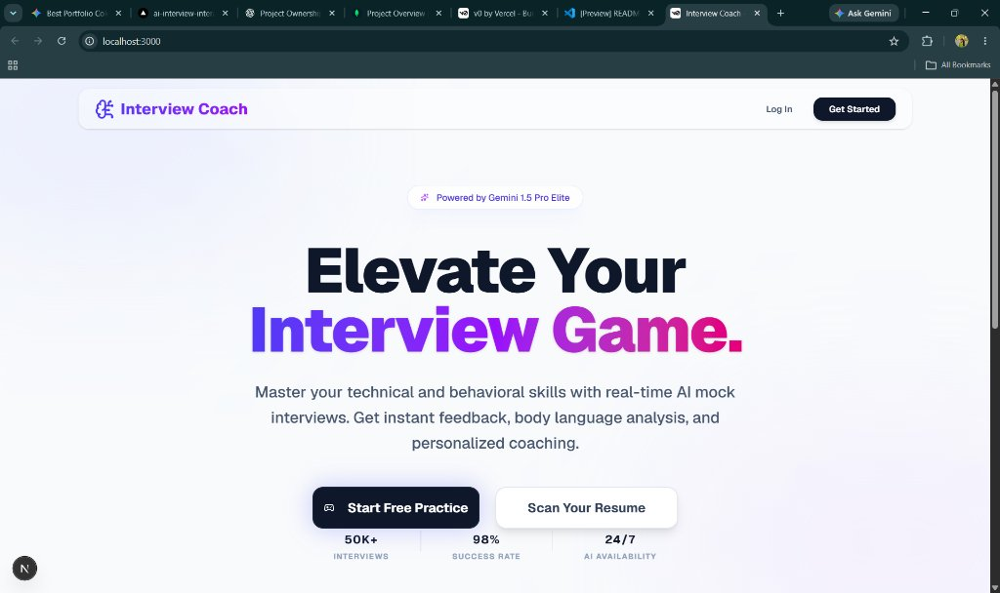
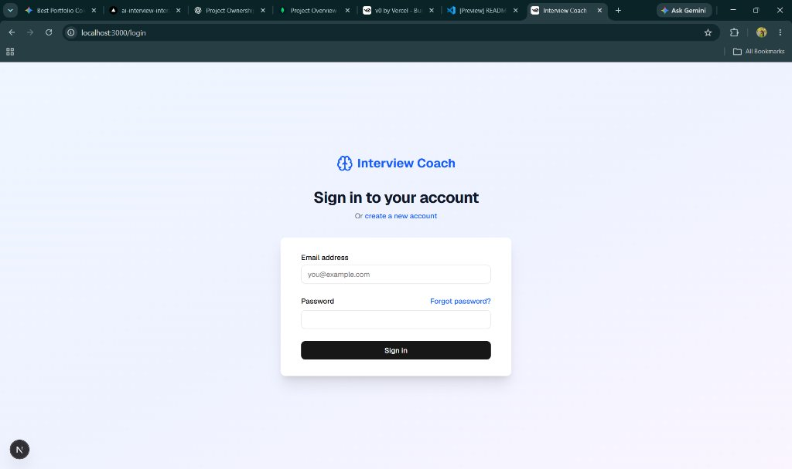
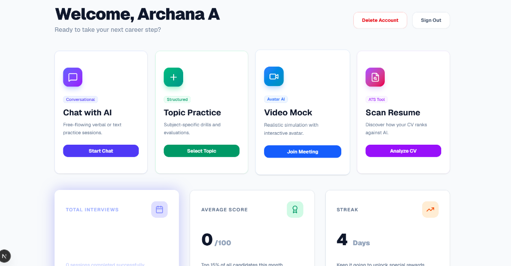
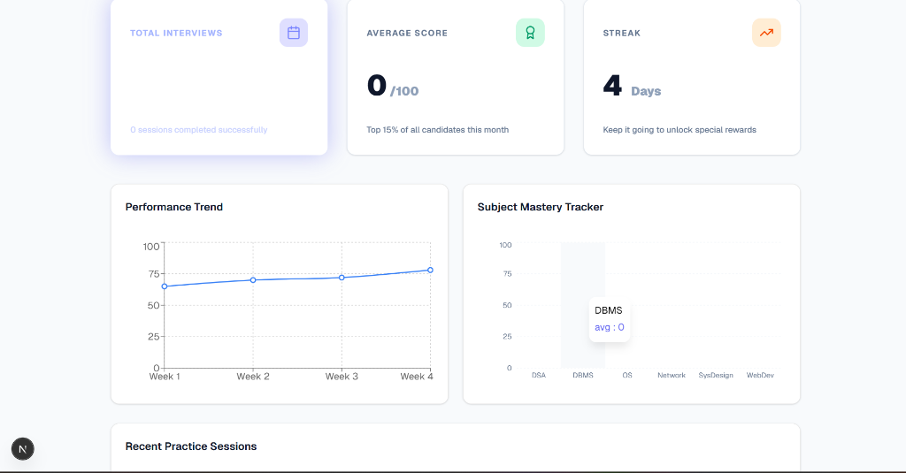
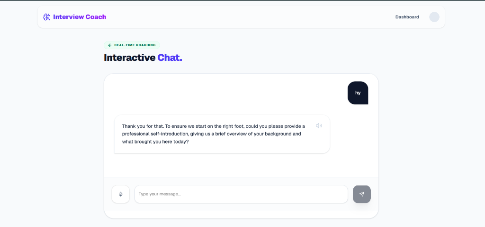
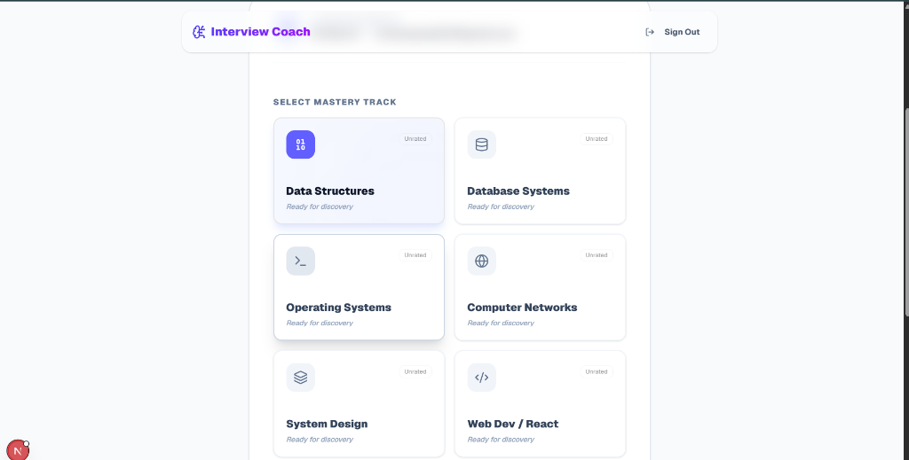
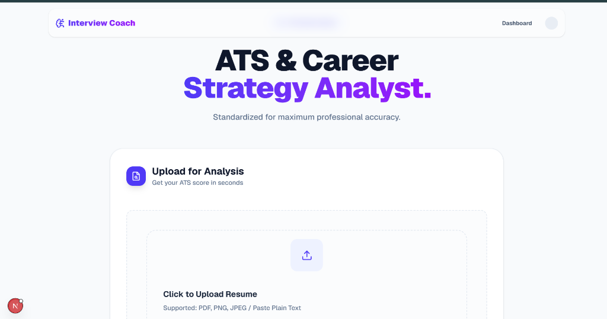

# 🚀 AI Interactive Interview coach

<p align="center">
  <strong>An AI-driven, voice-enabled mock interview platform that simulates real-world technical and HR panel interviews with real-time feedback, ATS resume analysis, and performance tracking.</strong>
</p>

<p align="center">
  
  
  
  
  
  
</p>

---

## 📸 Application Screenshots

<div align="center">

  <h3>🏠 1. Landing Page</h3>
  
  <br /><br />

  <h3>🔐 2. User Authentication</h3>
  
  <br /><br />

  <h3>📊 3. Candidate Dashboard</h3>
  
  <br /><br />

  <h3>📈 4. Performance Trends & Subject Mastery</h3>
  
  <br /><br />

  <h3>💬 5. Real-Time Coaching & Interactive Chat</h3>
  
  <br /><br />

  <h3>🎯 6. Technical Mastery Tracks</h3>
  
  <br /><br />

  <h3>📄 7. ATS & Career Strategy Analyst</h3>
  

</div>

---

## 💡 Why Interview Coach?

Most technical interview preparation tools rely on static flashcards, multiple-choice questions, or passive coding environments. However, real engineering and behavioral interviews require you to **verbalize your problem-solving process**, justify architecture decisions under pressure, and answer dynamic follow-up questions.

**AI Interactive Interview Platform** provides a realistic interview simulator designed to bridge this gap:
- **Talk, don't just type**: Integrated speech recognition captures spoken explanations in real-time.
- **Scenario-based challenges**: Questions adapt on the fly based on your background, target role, and answers.
- **Never fails mid-session**: Robust multi-tier LLM rotation and fallback mechanisms guarantee uninterrupted practice even during API downtime.

---

## ✨ Key Features

### 🎙️ 1. Voice-First Virtual Interviewer
- **Browser-Native Speech-to-Text**: Speak your answers naturally using browser speech recognition APIs with live transcription feedback.
- **Adaptive Follow-up Questions**: The AI evaluates your answer's depth and poses intelligent counter-questions to test edge cases, system bottlenecks, and alternative designs.
- **Timed Simulations**: Realistic timer countdowns help you build fluency under interview time constraints.

### 🧠 2. Dynamic Question Generation & Resilience
- **Context-Aware Scenarios**: Leverages Google Gemini models to craft senior-level system design, coding, and behavioral scenarios.
- **Multi-Model Fallback Engine**: If a specific model encounters rate-limits, the engine automatically cascades through alternative models (`gemini-2.5-flash`, `gemini-1.5-flash`, `gemini-pro`).
- **Heuristic Backup Analyzer**: In the event of total network or quota loss, an offline heuristic evaluator scores responses based on keyword density, structure, and depth, ensuring zero progress loss.

### 📄 3. ATS Resume Scanner & Evaluator
- **Applicant Tracking System (ATS) Scoring**: Upload your CV/resume (PDF, image, or text) to identify keyword density, impact verbs, and structural readability.
- **Actionable Improvement Checklist**: Receive clear recommendations to boost your match rate for target engineering roles.

### 📊 4. Performance Analytics Dashboard
- **Session History & Metrics**: Visualize performance trends across past interview sessions using interactive Recharts graphs.
- **Category Breakdowns**: Detailed scores on technical accuracy, clarity of communication, structured thinking, and depth.

### 🔐 5. Secure Authentication & Verification
- **Email Verification (OTP)**: Two-step account registration and password recovery powered by Nodemailer (Gmail SMTP).
- **Secure Sessions**: Passwords hashed securely, and stateful sessions maintained with MongoDB Atlas.

---

## 🛠️ Tech Stack

| Layer | Technology |
| :--- | :--- |
| **Frontend** | [Next.js 16](https://nextjs.org/) (App Router, Turbopack), [React 19](https://react.dev/), [TypeScript](https://www.typescriptlang.org/) |
| **Styling & UI** | [Tailwind CSS v4](https://tailwindcss.com/), [Radix UI](https://www.radix-ui.com/), [Shadcn UI](https://ui.shadcn.com/), [Lucide React Icons](https://lucide.dev/) |
| **Data Visualization** | [Recharts](https://recharts.org/) |
| **Database & ODM** | [MongoDB Atlas](https://www.mongodb.com/atlas) with [Mongoose](https://mongoosejs.com/) |
| **AI / Generative Models**| [Google Gemini API](https://ai.google.dev/) (`@google/genai`, `@google/generative-ai`) |
| **Speech & Audio** | Web Speech Recognition API (`dom-speech-recognition`), SpeechSynthesis API |
| **Email Services** | [Nodemailer](https://nodemailer.com/) (Gmail SMTP Integration) |

---

## 📁 Project Structure

```text
AI-Interactive-Interview-Platform/
├── app/
│   ├── (auth)/
│   │   ├── login/               # User login page
│   │   ├── signup/              # User registration with OTP verification
│   │   └── forgot-password/     # Password reset flow
│   ├── admin/                   # Administrative dashboards & user management
│   ├── api/                     # Backend API routes
│   │   ├── auth/                # signup, login, send-otp, forgot-password
│   │   ├── interviews/          # Interview creation, answer submission, streaming
│   │   ├── resume/evaluate/     # Resume ATS scanning endpoint
│   │   └── user/                # Profile & interview history
│   ├── dashboard/               # Performance tracking, past sessions & charts
│   ├── interview/               # Interactive interview chamber
│   ├── lobby/                   # Audio & microphone setup before interview
│   ├── onboarding/              # User skills, experience & CV onboarding
│   ├── resume/                  # ATS resume scanner interface
│   └── virtual-interview/       # Real-time voice interview view
├── components/                  # Reusable UI & business components (Radix/Shadcn)
├── hooks/                       # Custom React hooks (speech recognition, audio)
├── lib/                         # Database connection, schemas, Gemini AI helpers
│   ├── models/                  # Mongoose models (User, Otp, Interview)
│   ├── db.ts                    # User database helper queries
│   └── mongoose.ts              # Mongoose singleton connection manager
├── public/                      # Static assets & application screenshots
├── styles/                      # Global styles and Tailwind configuration
└── .env.local                   # Environment variables (private credentials)
```

---

## ⚡ Getting Started

### Prerequisites

Make sure you have the following installed on your machine:
- **Node.js** v18.18 or higher (v20+ recommended)
- **npm**, **pnpm**, or **yarn**
- A **Google Gemini API Key** (from [Google AI Studio](https://aistudio.google.com/app/apikey))
- A **MongoDB Atlas** cluster or a local MongoDB instance
- *(Optional)* A Gmail address with a **Google App Password** for sending verification emails

---

### Step 1: Clone the Repository

```bash
git clone https://github.com/your-username/AI-Interactive-Interview-Platform.git
cd AI-Interactive-Interview-Platform
```

### Step 2: Install Dependencies

```bash
npm install
# or
pnpm install
```

### Step 3: Configure Environment Variables

Create a `.env.local` file in the root directory by duplicating the example below:

```bash
cp .env.example .env.local
```

Populate the `.env.local` file with your credentials:

```env
# Google Gemini API Key
GEMINI_API_KEY=your_gemini_api_key_here

# MongoDB Connection String (MongoDB Atlas or local instance)
MONGODB_URI=mongodb+srv://<username>:<password>@cluster0.yourcluster.mongodb.net/interview-coach?retryWrites=true&w=majority

# Email Service (For OTP registration & password reset)
EMAIL_USER=your_email@gmail.com
EMAIL_PASS=xxxx xxxx xxxx xxxx
```

> [!TIP]
> **Generating a Google App Password**:
> 1. Go to your **Google Account** > **Security**.
> 2. Enable **2-Step Verification** (if not already enabled).
> 3. Search for **App passwords** and create an app password (name it e.g., "Interview Platform").
> 4. Copy the generated 16-letter code into `EMAIL_PASS`.

---

### Step 4: Run the Development Server

```bash
npm run dev
```

Open [http://localhost:3000](http://localhost:3000) in your browser to view the application.

---

### Step 5: Build for Production

```bash
npm run build
npm run start
```

---

## 📖 Walkthrough: Conducting a Mock Interview

1. **Sign Up & Verify**: Create an account with your email and verify using the 4-digit OTP sent to your inbox.
2. **Profile Onboarding**: Input your target job title, experience level, and key technical skills.
3. **Resume Check (Optional)**: Head to `/resume` to scan your CV against ATS filters.
4. **Interview Lobby**: Test your microphone and audio input before starting. Choose interview type (System Design, Frontend, Backend, or Behavioral) and difficulty level.
5. **Live Voice Session**: Listen to questions, formulate your answer, and toggle your microphone to speak. The AI transcribes your answer live and responds with contextual feedback.
6. **Detailed Evaluation**: After finishing, inspect your performance dashboard to review strengths, weakness tags, and recommended study areas.

---

## 🛡️ Reliability & Resilience

- **Connection Caching**: Database connections are cached globally in `lib/mongoose.ts` to prevent connection exhaustion during Next.js hot module reloading.
- **Fail-Safe Transcripts**: Speech recognition preserves interim transcripts to prevent data loss if microphone focus is toggled.
- **Credential Hygiene**: Sensitive credentials (passwords, tokens, and raw OTP codes) are stripped and never exposed in client API responses or server logs.

---

## 🗺️ Roadmap & Future Enhancements

- [ ] **Collaborative Whiteboard**: Draw architecture diagrams and database schemas in real-time alongside voice explanations.
- [ ] **Vector Store Knowledge Base**: Ingest framework-specific documentation (RAG) for hyper-specific technical inquiries.
- [ ] **Company-Specific Interview Tracks**: Preset rubrics mimicking real-world FAANG / Tier-1 interview formats.
- [ ] **Peer-to-Peer Mock Interviews**: Live video matching with peer candidates for collaborative practice.

---

## 📄 License

This project is licensed under the **MIT License** - see the [LICENSE](LICENSE) file for details.

---

<p align="center">
  Built with ❤️ for engineers preparing for their next big career milestone.
</p>
